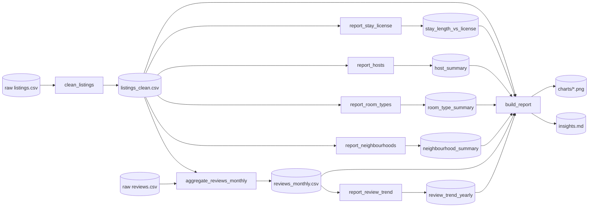

# MLOps – Data Versioning (Part A) and Data Lineage (Part B)

Part A: DVC vs Git LFS on the CrossFit athletes data (below). Part B: descriptive report on Chicago Airbnb data, with a Marquez lineage graph ([jump to Part B](#part-b--chicago-airbnb-reporting--data-lineage-marquez)).

## Part A

Predict `total_lift` (= deadlift + clean & jerk + snatch + back squat) on the CrossFit athletes
dataset, versioning the data with two tools: **DVC** and **Git LFS**.

## Repository layout

```
├── src/                     # ALL code (same files are used by both tools)
│   ├── common.py            # target, excluded columns, 80/20 split, preprocessing, metrics
│   ├── prepare_data.py      # builds dataset v1 or v2 -> data/train.csv, data/test.csv  (tasks 1-3)
│   ├── eda.py               # EDA of the version currently checked out                  (tasks 5, 9)
│   ├── train.py             # baseline LinearRegression - never edited between v1/v2    (tasks 6-7, 10-11)
│   ├── compare.py           # comparison tables                                          (tasks 12, 16)
│   └── dp_train.py          # non-DP vs DP-SGD neural net on v2 + epsilon                (tasks 14-15)
├── dvc/                     # Tool 1: DVC project (dvc init --subdir)
│   ├── data.dvc             # pointer to the dataset version (real data in the DVC store)
│   ├── logs/                # terminal output of every step (01_… to 12_…)
│   ├── metrics/             # v1.json, v2.json, v2_dp.json
│   └── reports/             # eda_v1/, eda_v2/  (summary.txt + plots)
├── gitlfs/                  # Tool 2: Git LFS project (same structure; data/*.csv stored in LFS)
├── .gitattributes           # Git LFS tracking rule
├── pyproject.toml, uv.lock  # Python environment (uv)
└── data/raw/athletes.csv    # original download - NOT committed (git-ignored)
```

Git tags mark the dataset versions: `dvc-v1`, `dvc-v2`, `lfs-v1`, `lfs-v2`.

## Dataset versions

- **v1**: the given dataset + `total_lift`. Rows where it can't be computed (a lift missing) are
  dropped. 85,191 rows. `name`/`athlete_id` are dropped too: they are never features, and this keeps
  athlete names out of this public repo.
- **v2**: the assignment's cleaning code, plus new features: `bmi`, `howlong_years` and 8 survey flags
  (college sports, no athletic background, started with a coach, Level 1 cert, trains others,
  multiple workouts per day, weighs food, paleo). 30,029 rows.
  - Fix to the given code: `v2['deadlift']` → `data['deadlift']`; as written it raises NameError.
  - Quirk in the given code: because `&` binds before `|`, the female deadlift cap (≤ 636) is never
    enforced, since any deadlift in (0, 1105] passes. Kept as given.
- Both versions: 80/20 train/test split, `random_state=42`. The 4 lift columns are excluded from
  features because `total_lift` is their sum (target leakage).

## Results (identical for both tools)

Baseline LinearRegression:

| dataset | RMSE | MAE | median AE | R² | test rows |
|---|---|---|---|---|---|
| v1 | 2,442,999 | 24,363 | 2,982 | −360.3 | 17,039 |
| v2 | 146.4 | 112.0 | 91.4 | 0.721 | 6,006 |

Neural net (Dense 32-16-1, SGD lr 0.05, 15 epochs, batch 250) on v2; DP uses
`DPKerasSGDOptimizer` with l2_norm_clip 1.0, δ = 1e-5, and ε from `compute_dp_sgd_privacy`:

| model | RMSE | MAE | R² | ε |
|---|---|---|---|---|
| non-DP | 143.4 | 109.2 | 0.732 | – |
| DP, noise 0.5 | 151.6 | 114.8 | 0.701 | 18.48 |
| DP, noise 1.1 | 151.7 | 114.9 | 0.701 | 2.12 |
| DP, noise 2.0 | 151.8 | 115.0 | 0.700 | 0.87 |

Linter: `ruff check src` → All checks passed; `pylint src` → 10.00/10.
Before cleanup, ruff found 12 issues and pylint scored 7.05/10.

## Reproduce

Setup (macOS):
```bash
brew install uv git-lfs && git lfs install
uv sync                         # installs pandas, scikit-learn, TF 2.15, TF Privacy 0.9, dvc, ruff, pylint
mkdir -p data/raw && unzip athletes.csv.zip -d data/raw
```

Tool 1 – DVC (run inside `dvc/`):
```bash
uv run dvc init --subdir && uv run dvc remote add -d localstore ../dvc-storage
uv run python ../src/prepare_data.py --version v1 --raw ../data/raw/athletes.csv
uv run dvc add data && git add data.dvc .gitignore && git commit -m "v1" && git tag dvc-v1 && uv run dvc push
uv run python ../src/prepare_data.py --version v2 --raw ../data/raw/athletes.csv
uv run dvc add data && git add data.dvc && git commit -m "v2" && git tag dvc-v2 && uv run dvc push

git checkout dvc-v1 -- data.dvc && uv run dvc checkout      # switch to v1
uv run python ../src/eda.py --name v1 && uv run python ../src/train.py --name v1
git checkout dvc-v2 -- data.dvc && uv run dvc checkout      # switch to v2 (no code change)
uv run python ../src/eda.py --name v2 && uv run python ../src/train.py --name v2
uv run python ../src/compare.py
uv run python ../src/dp_train.py --name v2 --noise 0.5,1.1,2.0 && uv run python ../src/compare.py
```

Tool 2 – Git LFS (run inside `gitlfs/`; the tracking rule is in the repo-root `.gitattributes`):
```bash
git lfs track "gitlfs/data/*.csv"       # run from repo root
uv run python ../src/prepare_data.py --version v1 --raw ../data/raw/athletes.csv
git add data && git commit -m "v1" && git tag lfs-v1
uv run python ../src/prepare_data.py --version v2 --raw ../data/raw/athletes.csv
git add data && git commit -m "v2" && git tag lfs-v2

git checkout lfs-v1 -- data             # switch to v1
uv run python ../src/eda.py --name v1 && uv run python ../src/train.py --name v1
git checkout lfs-v2 -- data             # switch to v2 (no code change)
uv run python ../src/eda.py --name v2 && uv run python ../src/train.py --name v2
uv run python ../src/compare.py
uv run python ../src/dp_train.py --name v2 --noise 0.5,1.1,2.0 && uv run python ../src/compare.py
```

Lint (repo root): `uv run ruff check src && uv run pylint src`

Note: the DVC store (`dvc-storage/`) is a local folder and is not pushed to GitHub. DVC data can only
be pulled on this machine; a shared remote (S3, Google Drive, …) would fix that. Git LFS data is
pushed to GitHub's LFS storage.

---

## TODO for submission (author's checklist)

All code has been run and every output is in `dvc/` and `gitlfs/`. What's left:

1. **Push** (from the repo root):
   `git push -u origin main --tags`
   - `--tags` matters: it publishes the dataset version tags.
   - The push also uploads ~40 MB of Git LFS data; GitHub's free quota is 1 GB.
   - Check on GitHub: `gitlfs/data/train.csv` should show "Stored with Git LFS".
2. **Deliverable 1, scripts for tasks 1-15**: submit `src/` (all 6 `.py` files) + `README.md`, or
   just the GitHub repo link. Optionally add `dvc/logs/` and `dvc/metrics/` as proof of output.
3. **Slide: linter output (task 13)**: screenshot of `dvc/logs/10_lint.txt`, or run
   `uv run ruff check src && uv run pylint src` in the terminal.
4. **Slide: non-DP vs DP (task 16)**: the neural-net table above + `dvc/logs/11_dp_train_v2.txt`.
5. **Slide: DVC vs Git LFS comparison**: see the table below; add your own impressions.
6. Optional screenshots: `git log --oneline --decorate`, `git lfs ls-files`, `cat dvc/data.dvc`,
   the EDA plots in `dvc/reports/eda_v1/` and `eda_v2/`.

### Tool comparison: DVC vs Git LFS (from running both on this project)

| Criterion | DVC | Git LFS |
|---|---|---|
| **What it is** | Separate tool on top of git. Git stores a small `.dvc` pointer file (md5 hash + size); the data lives in a DVC cache/remote | Git extension. Git stores a pointer file (sha256 + size) in place of each tracked file; the content goes to an LFS store |
| **Installation** | `pip install dvc` / `brew install dvc` (Python package, many dependencies; came with `uv sync`) | `brew install git-lfs` (single Go binary, ~30 s) |
| **Project setup** | `dvc init` (here `dvc init --subdir`, since it lives in a subfolder of the repo) + `dvc remote add -d <name> <path>` | `git lfs install` (once per machine) + `git lfs track "gitlfs/data/*.csv"` (writes `.gitattributes`) |
| **Setup gotchas hit** | 1) A root `.gitignore` rule `data/` stopped DVC from writing its own ignore file, so the first v1 commit failed. 2) `dvc remote modify ... url <relative path>` resolves relative paths in a confusing way: it was off by one folder until fixed | None. It worked first time |
| **Versioning a dataset** | 3 steps: `dvc add data` → `git add data.dvc` + `git commit` + `git tag` → `dvc push` | 2 steps: `git add data` + `git commit` + `git tag`; LFS upload happens automatically on `git push` |
| **Unit of versioning** | A whole directory as one object (`data/` → one `.dvc` file with `nfiles: 2`) | Individual files matching a pattern (`train.csv`, `test.csv` each get a pointer) |
| **Inspecting versions** | `cat data.dvc`, `git diff dvc-v1 dvc-v2 -- data.dvc` (hash and size change: 30.0 MB → 12.1 MB) | `git lfs ls-files` (oid per file), `git show lfs-v1:gitlfs/data/train.csv` shows the pointer |
| **Switching versions (same training code)** | 2 commands: `git checkout dvc-v1 -- data.dvc` then `dvc checkout`. Forgetting `dvc checkout` leaves the old data in place, a silent mismatch | 1 command: `git checkout lfs-v1 -- data`. Git's smudge filter swaps the real files in automatically |
| **Proof code is unchanged** | `git status` after switching: only `data.dvc` / ignored data changed, `src/` untouched | `git status`: only `data/*.csv` changed, `src/` untouched |
| **Where the data lives** | Anywhere you configure: local folder (used here), S3, GCS, Azure, Google Drive, SSH… Not tied to the git host | The git host's LFS server (GitHub here). Free tier is 1 GB storage + 1 GB/month bandwidth; this project uses ~40 MB |
| **Storage used** | Local cache `.dvc/cache` + remote `dvc-storage/` (~40 MB for both versions) | `.git/lfs` (~40 MB for both versions) |
| **Collaboration** | Others need `dvc pull` + access to the remote. Our local remote is not shareable, so a clone has pointers but no data | Clone/pull just works (LFS downloads automatically) for anyone with repo access |
| **Large-data scaling** | Designed for GB–TB datasets; cloud remotes and deduplication by content hash | Fine for MBs–a few GB; costs and quotas grow with the host's LFS pricing |
| **ML-specific features** | Pipelines (`dvc.yaml`, `dvc repro`), metrics/params tracking (`dvc metrics diff`), experiments (`dvc exp`) | None. It only stores big files |
| **Learning curve** | Steeper: two systems (git + dvc) and their commands must stay in sync | Low: once tracked, it is plain git |
| **Effect of DP on model metrics** | None from the tool. Identical numbers with both tools: R² 0.732 (non-DP) → ~0.70 (DP, ε 0.87–18.5) | Same |
| **Best for** | ML projects with large/evolving data, cloud storage, reproducible pipelines | Small/medium binary/data files in a normal git workflow |

**Takeaways for the slide**
- **Ease of installation:** Git LFS wins (one small binary). DVC is a heavier Python install, but trivial if you already use pip/uv.
- **Ease of data versioning:** Git LFS is simpler (plain git commands). DVC needs extra `dvc add`/`dvc push` steps and had two setup gotchas, but gives directory-level versions and storage flexibility.
- **Ease of switching versions:** both kept the training code untouched. Git LFS takes one command; DVC takes two, and forgetting `dvc checkout` is an easy mistake.
- **Effect of DP:** independent of the tool. DP cost about 0.03 R² (≈ +6 lb MAE) at every noise level tried; ε fell from 18.5 to 0.87 with almost no extra accuracy loss.
- **Verdict:** Git LFS for quick, small projects; DVC for real ML work (large data, cloud remotes, pipelines and experiments).

---

# Part B – Chicago Airbnb reporting + data lineage (Marquez)

Descriptive analytics only, no prediction. Data: [Inside Airbnb](https://insideairbnb.com/) Chicago
scrape from 2025-09-22: `listings.csv` (8,660 listings) and `reviews.csv` (492k reviews, 2009 to 2025).
Raw files sit in `data/raw/airbnb/`, which is git-ignored because it has host and reviewer names.

## Layout

```
partb/
├── pipeline.py              # 8 steps: clean -> aggregate -> 5 reports -> charts + insights
├── lineage.py               # sends OpenLineage START/COMPLETE events (with schemas) to Marquez
└── output/
    ├── clean/               # listings_clean.csv, reviews_monthly.csv
    ├── reports/             # neighbourhood / room_type / host / stay_length_vs_license / review_trend
    ├── charts/              # 6 PNGs for the report slide
    ├── insights.md          # the written insights (numbers filled in by the code)
    ├── lineage/             # Marquez screenshots: full + compact view
    └── lineage_events.jsonl # every lineage event that was sent (backup / proof)
```

## Transformations (what `clean_listings` etc. do)

- Keep 19 of 79 columns. Drop names, free text, URLs, photos and `host_id`.
- `price` "$1,234.00" → float. Drop rows with no price (835, mostly inactive) or outside $10–2000
  (placeholders like $50,000). 7,730 listings remain.
- `t`/`f` → 1/0. New groupings: `stay_type` (short-term vs 30+ nights), `license_status`
  (registered / pending / missing), `host_type` (single / 2–9 / 10+ listings).
- Reviews: join to listings, count per month. 5 summary tables from the clean data, then charts and
  `insights.md` from the summary tables.

## Data lineage

Marquez graph: `partb/output/lineage/marquez_lineage_compact.png`. Same flow:



Source → transformation → reporting: 2 raw sources, 2 cleaning/aggregation jobs, 5 report jobs,
1 reporting job. That's 8 jobs and 11 datasets in Marquez namespace `airbnb-chicago-reporting`.
Every dataset node carries its column schema; every job carries a description.

## Results / insights (from `partb/output/insights.md`)

- **Where:** Near North Side, West Town and Near West Side hold 28% of listings (76 neighbourhoods).
  The priciest areas are Near North Side ($231 median), Loop ($222) and Near South Side ($213), vs $152 citywide.
- **What:** 80% of listings are entire homes/apts (median $177/night) vs private rooms at $60.
  Ratings are high everywhere: median 4.87/5; superhosts 4.91 vs others 4.77.
- **Who:** 69% of listings belong to multi-listing hosts. Operators with 10+ listings run 35% of
  the market, charge more ($195 vs $145) and rate lower (4.83 vs 4.91) than single-listing hosts.
- **Rules:** 34% of listings require 30+ night stays, and only 6.5% of those have a city license,
  vs 99.5% of short-term listings. Chicago doesn't require registration for 30+ day rentals, so many
  hosts likely set long minimum stays to avoid it.
- **When:** reviews fell 50% in 2020 (COVID), passed 2019 levels again in 2021 and peaked at 102k
  in 2024. August is the busiest month, February the quietest (about 2.9x apart).

## Reproduce Part B

```bash
# one-time: Docker without Docker Desktop
brew install colima docker docker-compose
colima start --cpu 4 --memory 6 --vm-type vz --vz-rosetta
#  (in ~/.docker/config.json: "cliPluginsExtraDirs": ["/opt/homebrew/lib/docker/cli-plugins"])

# Marquez (cloned to ~/Downloads/MLops/tools/marquez, tag 0.51.1).
# API on 9000 because macOS AirPlay already uses port 5000.
cd ~/Downloads/MLops/tools/marquez
./docker/up.sh --tag 0.51.1 --api-port 9000 --api-admin-port 9001 --detach --no-search

# data + pipeline (from this repo's root)
mkdir -p data/raw/airbnb && cp ~/Downloads/listings.csv ~/Downloads/reviews.csv data/raw/airbnb/
uv run python partb/pipeline.py
# lineage UI: http://localhost:3000 -> Jobs -> build_report (toggle "Compact Nodes")

# when done:  ./docker/down.sh  (in the marquez folder)  and  colima stop
```

Lint: `uv run ruff check partb && uv run pylint partb` → All checks passed, 10.00/10.

## TODO for Part B submission

Part B is code-complete; what's left is the 2 slides.

1. **Slide: report + insights.** Title like "Chicago Airbnb, Sept 2025: who, where, what, when".
   - Use 3–4 charts from `partb/output/charts/`. The strongest are `5_license_by_stay_type.png`
     (the regulation finding), `6_reviews_per_month.png` (COVID dip + seasonality),
     `1_top_neighbourhoods.png` or `2_priciest_neighbourhoods.png`, and `4_host_size.png`.
   - Add 4–5 one-line insights from the list above.
   - Footnote: "Inside Airbnb, Chicago, scraped 2025-09-22; 7,730 listings after cleaning;
     reviews used as a booking proxy".
2. **Slide: data lineage diagram.** Use `partb/output/lineage/marquez_lineage_compact.png`, or
   take your own screenshot at http://localhost:3000 (Marquez must be running, see above).
   - Label the three zones on the slide: **Sources** (raw listings, raw reviews) →
     **Transformations** (clean_listings, aggregate_reviews_monthly) → **Reporting**
     (5 report jobs → build_report → insights.md + charts).
   - One line on the tooling: "Lineage captured with OpenLineage events from the Python pipeline;
     visualised in Marquez 0.51 (Docker)."
3. Submit the code with the Part A files: `partb/pipeline.py` and `partb/lineage.py` (+ README),
   or the repo link.
4. Push: `git push origin main` (no force needed this time).
